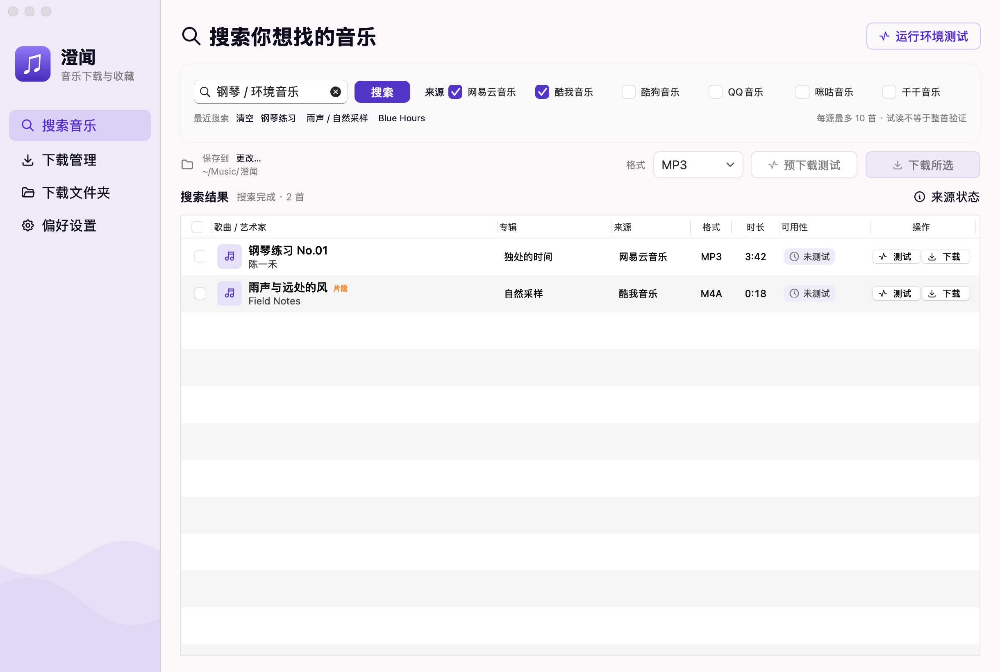

# 澄闻

**macOS 音乐下载与收藏**

**0.9.5** · [Apple Silicon（M 系列）DMG](https://github.com/ixiehao/chengwen/releases/download/v0.9.5-preview.1/chengwen-0.9.5-preview.1-arm64.dmg) · [Intel DMG](https://github.com/ixiehao/chengwen/releases/download/v0.9.5-preview.1/chengwen-0.9.5-preview.1-x86_64.dmg)

## 功能

- 按歌名、歌手或专辑搜索，可同时勾选网易云音乐、酷我音乐、酷狗音乐、QQ 音乐、咪咕音乐和千千音乐。
- 单首或批量下载，可选原始格式、MP3、M4A、FLAC 或 WAV。音源提供歌词时可同时保存 LRC 文件。
- 下载前可试读音频，下载后校验整首文件。同名文件会自动编号。
- 查看下载进度和历史记录，重试失败任务或切换音源。
- 默认免登录。也可在设置中连接网易云音乐或酷我音乐账号，并选择在下载时使用已连接账号。可下载的歌曲以平台提供的权限为准。

## 安装

最低部署目标为 macOS 12。打开对应芯片的 DMG，将「澄闻」拖入「应用程序」。安装包采用临时签名，尚未经过 Apple 公证。[发布说明与 SHA-256 校验文件](https://github.com/ixiehao/chengwen/releases/tag/v0.9.5-preview.1)

下载和音频转换需要安装 FFmpeg 与同目录的 FFprobe。打开澄闻后，在右上角的「运行环境测试」查看安装方法和工具状态。[音频工具安装](docs/AUDIO_TOOLS.md)

澄闻采用 MIT 许可证。[从源码运行](docs/DEVELOPMENT.md) · [许可证](LICENSE) · [第三方声明](THIRD_PARTY/README.md) · [隐私](PRIVACY.md) · [安全报告](SECURITY.md) · [项目文档](docs/README.md)
